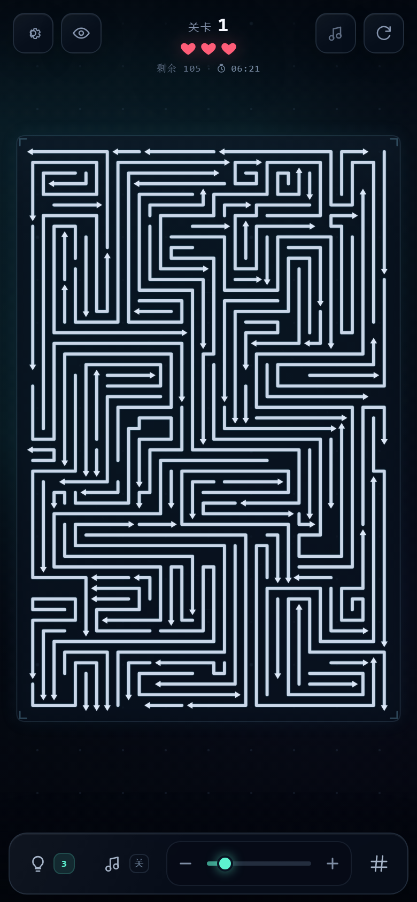
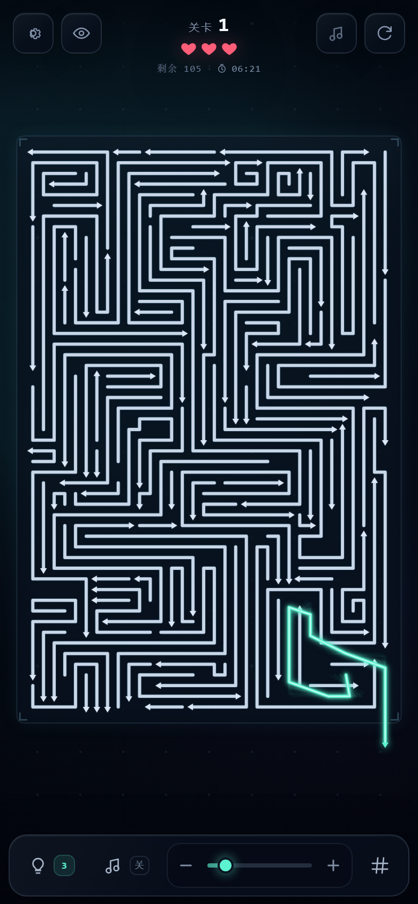
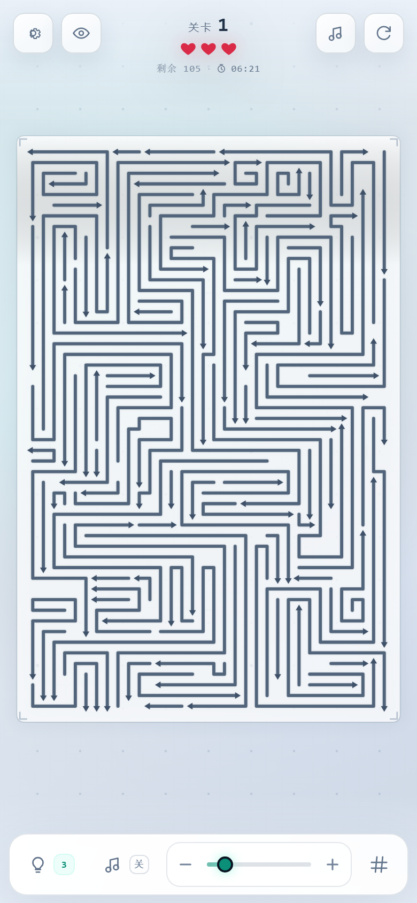

# Arrow Maze · 箭头迷宫

高密度、极简霓虹风格的「箭头迷宫清理」网页游戏。
点击带箭头的折线，箭头会带头向前游出，整条线像蛇一样顺着自己的轨迹逐节抽离；
路径被其他线挡住就会碰撞、扣血并弹回。清完所有线段即可进入下一关。

使用 **纯 Canvas 2D + 原生 JavaScript（ES Modules）**，零运行时依赖。





## 运行

需要 Node.js 18+（仅用于启动静态服务器，游戏本身零依赖）。

```bash
cd D:\02_Git\个人项目\arrow-maze
npm start
```

打开 <http://localhost:4173>。

移动端测试：手机与电脑连同一局域网，终端会打印 `Network:` 地址，手机访问对应地址即可。
因为使用 ES Modules，不能直接 `file://` 双击 `index.html`，需要静态服务器。

```bash
npm test        # 几何 / 碰撞 / 自撞过滤 / 限时 / 关卡可解性 / 摄像机测试
```

## 部署到 GitHub Pages

这个项目不需要构建，所有资源都走相对路径，直接作为静态站点发布。

1. 在 GitHub 新建空仓库，例如 `arrow-maze`，不要勾选初始化 README。
2. 在项目目录执行：

```bash
git init -b main
git add .
git commit -m "feat: arrow maze"
git remote add origin https://github.com/<你的用户名>/arrow-maze.git
git push -u origin main
```

3. 打开仓库 **Settings → Pages**：
   - Source 选择 **Deploy from a branch**
   - Branch 选择 `main`
   - Folder 选择 `/ (root)`
   - 保存。
4. 等待 1~2 分钟，访问：

```text
https://<你的用户名>.github.io/arrow-maze/
```

仓库里带了 `.nojekyll`，避免静态文件被 Jekyll 处理。

### 如果放在个人项目 monorepo 里

GitHub Pages 不能直接把仓库子目录作为站点根目录，需要用 GitHub Actions 把 `arrow-maze` 目录作为 artifact 上传，或单独建仓库。

### 注意事项

- 免费 GitHub Pages 通常需要 public 仓库；private 仓库是否可用取决于当前 GitHub 套餐。
- 页面是 HTTPS 的，`localStorage`、IndexedDB 本地音乐库、文件选择器都能正常工作。
- 首次打开仍需要用户手势才能播放音频，这是浏览器策略，不是部署问题。
- 更新后如果看到旧页面，先 `Ctrl + F5` 强刷；GitHub Pages 的缓存通常几分钟内更新。
- 如果要绑定自己的域名，在 Pages 设置里填 Custom domain，并在域名商添加 CNAME 记录。

## 操作

| 操作 | 效果 |
| --- | --- |
| 点击 / 轻点线段或箭头 | 箭头带头，身体沿轨迹蛇形抽离；被挡住则碰撞并弹回 |
| 拖动空白处 / 棋盘 | 平移地图（放大后有明显效果） |
| 双指捏合 | 缩放地图，底部滑块同步 |
| 鼠标滚轮 | 围绕鼠标位置缩放 |
| 底部滑块 / `+` `-` | 缩放；`0` 键回到适配尺寸 |
| 灯泡按钮 / `H` | 使用一次提示，高亮一条当前可安全清除的线 |
| `#` 按钮 / 眼睛按钮 / `G` | 开关辅助线（网格 + 当前线的飞出射线） |
| 顶部齿轮 | 打开设置 |
| 底部「音乐」/ 顶部音符 | 开关当前背景音乐；还没选音乐时会打开设置 |
| 顶部循环箭头 / `R` | 重新开始本关 |

## 玩法与规则

- 每条线是带拐角的折线，末端有明确箭头。
- 点击后箭头头部向前移动，身体的每个折点按固定弧长跟随，像蛇一样把折角逐节拉直并游出棋盘。
- 撞到其他线段：扣 1 点生命、屏幕四周出现红色边框、音效与移动端震动，然后弹簧式弹回。
  受击特效只使用一个轻量 CSS 红框，不做粒子、屏幕抖动或全屏重绘，避免掉帧。
- 生命耗尽：弹出结算；可以调高生命、设置为无限，或重试本关。
- 每关有限时倒计时，默认基础 6 分钟；可在设置里调整。
  计时从第一次点击/轻点游戏画面开始，未点击前不会流逝；使用提示也会开始计时。
  时间归零会弹出「时间到」，可以重试或调整设置；关卡更高、线条更多时会自动加长。
- 清完所有线：弹出「关卡完成」，进入下一关。
- 关卡是种子化生成的：同一关每次重新开始布局一致。

### 设置项

- **生命数量**：`-1` 为无限生命；其它值最少 1，最多 99。修改后立即更新 HUD。
- **提示次数**：`-1` 为无限提示，`0` 为关闭提示。每使用一次提示扣 1 次。
- **关卡时间**：默认 6 分钟基础时间，可调 1~30 分钟；修改后本关立即按已用时间重算，
  下一关也沿用。关卡越高、箭头越多仍会自动加时；开局不计时，第一次点击画面才开始。
- **背景音乐**：底部工具栏有独立「音乐」开关；在设置 → 声音 → 音乐库里选择本地音乐
  （可多选），文件保存在浏览器 IndexedDB 中，刷新后仍可使用。
- **难度曲线**：安全线从第 1 关的 8 条逐步降到 3 条，高关卡线条更长、拐弯更多；
  不会只靠随机布局忽难忽易。
- **限时**：每关有倒计时，默认基础 **6 分钟**；时间到会弹出「时间到」并允许重试。
  公式为 `基础分钟*60 + (关卡-1)*15 + 箭头数*0.2` 秒，基础分钟可在设置里调整。
- **本机记录**：累计通关次数保存在 `localStorage`，刷新/重开浏览器都在；
  设置里可查看，重置进度不会清空。
- **音效**：独立开关与音量。
- **外观**：黑夜霓虹 / 白天纸感，可即时切换，Canvas、HUD、设置面板同步换色。
- **辅助线**：默认关闭，可随时打开。
- **重置进度**：回到第 1 关。
- 设置、主题、关卡进度、累计通关次数会保存在 `localStorage`。

### 黑夜 / 白天



主题同时作用于 DOM 和 Canvas：CSS 通过 `[data-theme]` 切换 HUD/弹窗，
Canvas 通过 `CONFIG.themes` 调色板切换背景、棋盘、线段、箭头和高亮色。
刷新后主题会保留。

## 背景音乐与音效

- **不再默认播放内置合成音乐**，避免一段固定 BGM 不符合玩家口味。
- 设置 → 声音 → 音乐库 → **选择文件 / 选择文件夹**；
  可以一次导入多首本地音乐，文件以 Blob 存入浏览器 IndexedDB，刷新后仍然保留，不会上传服务器。
- 最多保存 20 首，单首建议不超过 30MB；可随时切换或删除。
- 底部「音乐」开关、顶部音符和设置里的开关都控制当前曲目；没有选择曲目时会提示先选择音乐。
- 点击、成功清除、碰撞音效重新设计为轻柔噪声扫频、软泡泡和低频闷响，
  并加入压缩器，避免原来刺耳的电子蜂鸣；箭头的“嗖”声不再用高频正弦蜂鸣。
- 浏览器要求首次用户手势后才允许出声，第一次点击/触摸后开始播放。

## 关卡生成与可解性

`src/game/systems/LevelGenerator.js` 使用 35×54 格、每格 24 世界像素的棋盘，
核心是“空间感知地长出一条长线”，而不是随机扔短折线：

1. 从空格出发，在不与已有线接触的格点/边里持续生长，目标 6~12 段；
2. 每一段在直行、左转、右转和 1~5 格长度里选择，长墙优先，空间不够才缩短；
3. 线变长以后，再分别尝试两个端点作为箭头，避免只有一端可解；
4. 新线与已有线的双向阻挡关系进入依赖图，只有图仍然无环才接受；
5. 依赖图保证存在合法清线顺序；安全线目标从第 1 关 8 条逐步降到 3 条；
6. 空间被长线占满后，自动用短线填补剩余小孔，不会留下大片空白；
7. 最后过滤箭头穿身、盘成小螺旋/死结的线，避免出现视觉上像“关死了”的图形。

当前关卡通常有 **90~110 条长线**（第 1 关截图是 105 条，8 条安全线）。
线条平均约 5~6 段，很多会横跨大半个棋盘，而不是碎成小折线。
同一关由固定 seed 生成，重开不会变布局。

## 蛇形运动与碰撞

### 蛇形抽离

`ArrowLine.getPointsAt(offset)` 把「原始折线 + 箭头前方射线」看成一条轨道：

- 头部沿轨道前进 `offset`；
- 身体每个折点始终落后头部固定弧长；
- 于是尾巴会沿着原折线依次滑出，折角被逐节拉直，而不是整条线刚性平移。

由于身体只在「原折线 + 头部射线」这条轨道上移动，而原折线覆盖的区域初始没有其他线段，
所以真正会进入新空间的只有箭头头部的射线。

### 碰撞

`src/game/systems/CollisionSystem.js` 提供两套算法：

1. **游戏内蛇形碰撞**：`findRayBlock()` 从箭头尖沿方向发射一条带线宽的胶囊射线，
   精确求出与静态线段首次接触的距离。它和蛇形动画的头部位置严格一致，不会出现
   “眼睛看没碰到但判定撞了”的情况。
2. **关卡生成**：先在空格里生长长折线，再用同一套蛇形射线规则检查新线是否被挡住、
   是否挡住已有线，把关系加入依赖图并保持无环；最后拓扑排序得到清线顺序。
3. `findBlockingOffset()` 的保守扫掠实现保留用于回归测试。

碰撞后移动线和挡路的线都会短暂标红，屏幕四周同时出现红色边框，便于快速定位。

射线与胶囊的接触距离由 `rayCapsuleFirstHit()` 解析计算，不依赖帧采样，速度快且不会穿模。
两线碰撞时中心距阈值为 `(宽度A + 宽度B) / 2 + padding`。

## 代码结构

```text
arrow-maze/
├─ index.html                          # HUD、工具栏、设置/结算弹窗
├─ favicon.svg
├─ package.json
├─ server.mjs                          # 零依赖静态服务器，支持局域网访问
├─ docs/
│  ├─ preview.png                      # 黑夜主题
│  ├─ preview-light.png                # 白天主题
│  └─ snake-motion.png                 # 蛇形抽离
├─ src/
│  ├─ main.js                          # DOM 引用、启动 Game
│  ├─ config.js                        # 棋盘/线宽/动画/主题调色板/默认设置
│  ├─ styles.css                       # 霓虹 HUD、黑夜/白天、弹窗、响应式
│  └─ game/
│     ├─ Game.js                       # 主循环、输入、关卡、设置、音效、渲染
│     ├─ Camera2D.js                   # 缩放、平移、适配与边界限制
│     ├─ entities/
│     │  └─ ArrowLine.js               # 折线数据、蛇形采样、滑出/碰撞状态机
│     ├─ systems/
│     │  ├─ CollisionSystem.js         # 蛇形射线 + 保守扫掠碰撞
│     │  └─ LevelGenerator.js          # 包裹折线 + 增量拓扑可解性生成
│     ├─ render/
│     │  ├─ BackgroundRenderer.js      # 缓存背景（跟随主题重绘）
│     │  ├─ BoardRenderer.js           # 棋盘、网格、方向射线
│     │  └─ LineRenderer.js            # 批量线段、箭头、高亮、残影
│     ├─ audio/
│     │  ├─ AudioManager.js            # 本地 BGM 播放 + 合成音效
│     │  └─ MusicLibrary.js            # IndexedDB 本地音乐库
│     └─ utils/
│        ├─ color.js                   # 十六进制颜色转 rgba
│        ├─ difficulty.js              # 限时公式与倒计时格式化
│        ├─ geometry.js                # 线段距离、射线胶囊、扫掠四边形、AABB
│        └─ Tween.js                   # 缓动与 Tween
└─ tests/
   └─ geometry.test.mjs                # 23 项 Node 测试
```

## 核心数据

```js
// ArrowLine 实例
{
  points: [{ x, y }, ...], // 起点 → 拐点 → 终点，世界坐标
  direction: 'right',      // right | left | up | down
  offset: 0,               // 箭头头部沿轨道前进的弧长
  state: 'idle',           // idle | sliding | hitting | bouncing | cleared
  cleared: false,
  width: 7
}
```

渲染、点击命中和碰撞都读取 `getPoints()` 返回的当前几何，保证视觉位置与逻辑位置一致。

## 测试覆盖

```bash
npm test
```

共 23 项：

- 点到线段 / 折线的最短距离
- 线段相交、共线重叠、线段到凸四边形距离
- 箭头三角形命中
- 蛇形采样：L 形从尾巴开始逐节抽直
- 蛇形出屏距离 = 身体长度 + 头部到边缘距离
- 射线到胶囊体的首次接触距离
- 蛇形移动时身体侧面的障碍不会误判
- 保守扫掠碰撞的接触距离与旁侧线排除
- 关卡密集度、四方向、初始无接触、安全线随难度从 8 降到 3
- 箭头射线穿过自身身体会被识别为自撞，生成器会过滤
- 紧凑螺旋/死结线条会被质检过滤
- 依赖图无环、拓扑顺序逐步清线可解
- 按生成器 `solution` 顺序逐步验证可解性
- 多个 seed 关卡的完整可解集合
- 限时随关卡/线数增加，倒计时格式化正确
- 难度曲线：安全线逐级减少、目标段数逐级增加
- ArrowLine 滑出状态机
- Tween 边界
- Camera2D 世界/屏幕坐标可逆与围绕指定点缩放

## 兼容性

Chrome / Edge / Firefox / Safari 近期版本。
使用 Canvas 2D、Pointer Events、ES Modules、`dialog`、CSS `dvh` / safe-area。
`prefers-reduced-motion` 开启时会缩短滑出与弹回动画。

桌面端画面会保持竖版棋盘居中；手机竖屏是主要体验场景，横屏下可双指放大后操作。
